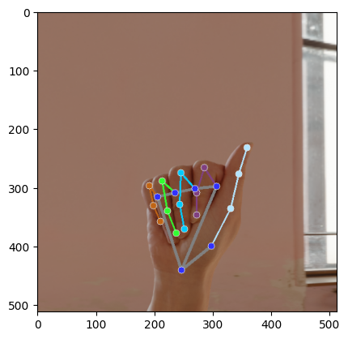

# ASL Interpreter

This workshop uses computer vision for sign-language classification. Students first extract hand landmarks with MediaPipe, then train models that classify hand signs from either landmarks or images.

## Notebooks

| Notebook | Use |
| --- | --- |
| [asl-interpreter-beginner.ipynb](asl-interpreter-beginner.ipynb) | Starter version with more scaffolding. |
| [asl-interpreter-intermediate.ipynb](asl-interpreter-intermediate.ipynb) | Student version with implementation gaps. |
| [asl-interpreter-advanced.ipynb](asl-interpreter-advanced.ipynb) | More independent implementation. |
| [asl-interpreter-solutions.ipynb](asl-interpreter-solutions.ipynb) | Completed reference notebook. |

The [requirements.txt](requirements.txt) file is a workshop package list, and [temp.py](temp.py) retains a Python export of the workshop material. The notebooks are the main entry points. The package list is incomplete for the notebooks: they also import scikit-learn, TensorFlow and tqdm, and the OpenCV import `cv2` is provided by the `opencv-python` package.

## What Students Build

- An OpenCV image-loading and color-conversion pipeline.
- A MediaPipe hand-landmark extractor.
- A RandomForest classifier over normalized hand landmarks.
- A neural-network extension for classifying images directly.
- An inference function for testing a photo uploaded by the student.

## Run It

This workshop was designed for Kaggle.

1. Import one of the notebooks from GitHub.
2. Turn on internet access.
3. Attach the Kaggle dataset named `synthetic-asl-alphabet`. The notebooks expect letter-labelled image folders under `/kaggle/input/synthetic-asl-alphabet/Train_Alphabet`; check the attached file tree before running.
4. Run the notebook setup cell for MediaPipe and the other computer-vision dependencies.
5. For the inference section, upload a test image as a Kaggle dataset and update the path in the notebook.

The dataset and example personal test photo are not bundled here. The notebooks do not identify the dataset owner, so use the dataset name and expected folder layout rather than assuming an owner-specific URL. For local use, provide the imported libraries and replace the Kaggle paths with your dataset and test-image locations.

## Related Workshops

Some notebook refresher links use the previous repository layout. Use [Intro to Machine Learning](../../TheoreticalWorkshops/intro-to-machine-learning/README.md) and [Computer Vision with CNNs](../../TheoreticalWorkshops/intro-to-convolutional-neural-networks/README.md). For the decision-tree material mentioned in the notebook, use the [legacy machine-learning workshop](../../TheoreticalWorkshops/intro-to-machine-learning/legacy/v1-intro-to-machine-learning/IntroToML/README.md).

## Credits

This notebook was created by Edinburgh AI for use in its workshops. If you reuse it, please credit Edinburgh AI.
