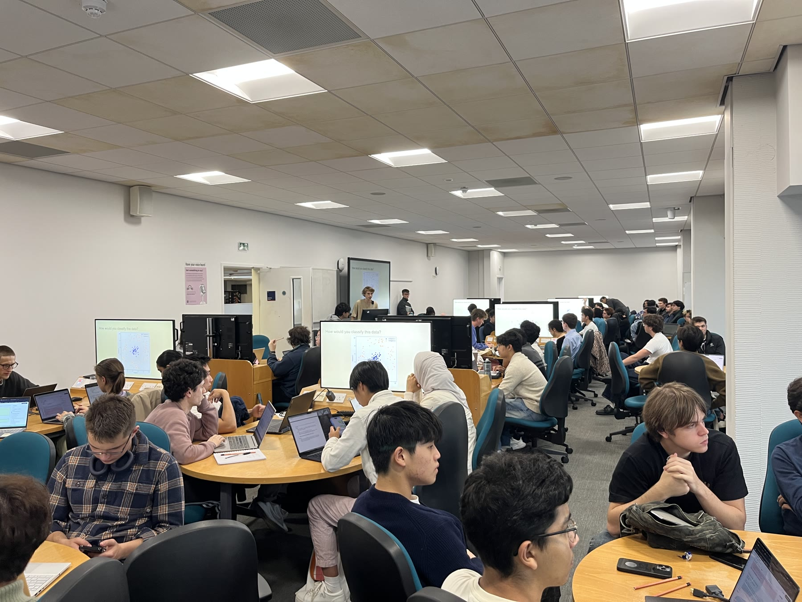

# Edinburgh AI Workshop Resources



<a href="https://pytorch.org/get-started/locally/"></a>
<a href="https://scikit-learn.org/stable/"></a>
<a href="https://pandas.pydata.org/"></a>
<a href="https://www.kaggle.com/"></a>

Edinburgh AI runs beginner-friendly AI workshops at the University of Edinburgh. This repo contains the notebooks, datasets, helper code, and solution files used across different weekly sessions.

Each workshop focuses on a concrete build or activity: a regression model, a neural-network classifier, CNN visualisation, language models, a podcast generator, object detection, sign-language classification, a Flappy Bird reinforcement-learning agent, a judo sequence model, or a reels recommender. Dataset and setup requirements vary by workshop.

Most sessions were designed around Kaggle because it gave students the easiest shared environment: browser notebooks, dataset attachment, optional GPUs, and minimal local setup.

## Workshop Catalogue

| Area | Workshop | What students build | Main stack |
| --- | --- | --- | --- |
| Foundations | [Intro to Machine Learning](TheoreticalWorkshops/intro-to-machine-learning/README.md) | Linear regression and a quadratic-feature extension using embedded synthetic data | pandas, scikit-learn |
| Foundations | [Neural Networks](TheoreticalWorkshops/intro-to-neural-networks/README.md) | A first PyTorch neural network and MNIST classifier | PyTorch, torchvision |
| Foundations | [Computer Vision with CNNs](TheoreticalWorkshops/intro-to-convolutional-neural-networks/README.md) | Convolution demos, satellite-image classification, transfer learning and face segmentation | PyTorch, torchvision, transformers |
| Foundations | [Language Models](TheoreticalWorkshops/intro-to-large-language-models/README.md) | Embeddings, semantic search, sentiment fine-tuning and GPT-2 generation | gensim, sentence-transformers, transformers |
| Theoretical | [CNN Class Visualisation](TheoreticalWorkshops/cnn-class-visualisation/README.md) | Images optimised to activate classes and intermediate layers of a frozen ResNet50 | PyTorch, torchvision |
| Theoretical | [Single-Object YOLO Detection](TheoreticalWorkshops/yolo-single-raccoon-box-bounding/README.md) | A raccoon detector with confidence/box loss and IoU evaluation | PyTorch, pandas, PyYAML |
| Theoretical | [Where's Wally? Detection](TheoreticalWorkshops/yolo-wheres-wally/README.md) | Synthetic training images and a CNN with a heatmap and bounding-box head | PyTorch, torchvision, Pillow |
| Theoretical | [Sports Vision with RNNs and LSTMs](TheoreticalWorkshops/intro-to-rnn-lstm/README.md) | Clip-level judo throw-attempt classification, plus a no-code beginner activity | PyTorch, NumPy, scikit-learn; browser app |
| Practical | [Notes to Podcast](PracticalWorkshops/Notes-To-Podcast/README.md) | A local RAG pipeline that turns university notes into a two-host podcast | FAISS, Ollama, Kokoro TTS |
| Practical | [ASL Interpreter](PracticalWorkshops/ASL-Interpreter/README.md) | Sign-language classification using hand landmarks and image models | MediaPipe, OpenCV, scikit-learn, TensorFlow |
| Practical | [Flappy Bird RL](PracticalWorkshops/Flappy-Bird/README.md) | A DQN agent trained to play Flappy Bird | Gymnasium, PyTorch |
| Practical | [Instagram Reels Recommendation](PracticalWorkshops/Instagram-Reels-Recommendation/README.md) | An HSTU sequential recommender, plus a no-code recommendation activity | PyTorch, pandas; browser app and AI chat tool |

## How To Run A Workshop

Read the selected workshop's README first to choose a notebook and check its data requirements. The usual coding route is Kaggle:

1. Go to [kaggle.com](https://kaggle.com) and create an account.
2. Create a new notebook.
3. Download the linked student `.ipynb` file from this repository and import it into the new notebook. If GitHub import is available, select `EdinburghAI/workshops` and the topic-based notebook path instead.
4. Turn on internet access when the notebook needs package, model or data downloads.
5. Attach the datasets listed in that workshop's README and check that the input paths match. Some workshops embed their data, download it in code or collect experience from a game instead.
6. Enable a GPU where the workshop recommends one.
7. Run the cells in order, complete the `TODO` prompts and use the solved notebook as a reference.

Each workshop folder has its own README with the exact notebooks, datasets, outputs, and takeaways for that session.

The beginner Sports Vision and Reels notebooks are activity guides using external browser apps; they do not require Python execution. Follow their workshop READMEs for the app links and instructions.

For local coding, use Jupyter or another notebook environment and follow the workshop-specific dependency and path guidance. The root [pyproject.toml](pyproject.toml) and [uv.lock](uv.lock) describe a Python 3.11 environment with a subset of dependencies; they are not a complete environment for every workshop. Notes to Podcast also uses Linux system packages and an Ollama service. Local runs have not been standardised across all topics.

## Repository Layout

```text
TheoreticalWorkshops/
  intro-to-machine-learning/
    legacy/v1-intro-to-machine-learning/IntroToML/
    legacy/v1-intro-to-machine-learning/generation/
  intro-to-neural-networks/
    legacy/v1-intro-to-neural-networks/
  intro-to-convolutional-neural-networks/
  intro-to-large-language-models/
  cnn-class-visualisation/
  yolo-single-raccoon-box-bounding/
    workshop-notebooks/
    yolo-workshop-api/
  yolo-wheres-wally/
    notebook-dataset/
  intro-to-rnn-lstm/
    legacy/

PracticalWorkshops/
  Notes-To-Podcast/
  ASL-Interpreter/
  Flappy-Bird/
  Instagram-Reels-Recommendation/
```

Workshops are organised by topic within theoretical and practical groups, rather than by semester and workshop number. The notebooks at each topic's main level (or its documented `workshop-notebooks/` folder) are the main version. Earlier deliveries are retained under `legacy/` where present. Difficulty variants within the main version are alternatives for the same workshop, rather than separate deliveries.

Notebook filenames retain their original spelling, including the double `.ipynb` extension on the CNN visualisation solution. Notebook titles may still show historical session numbers and dates. Use this catalogue and the topic READMEs for navigation.

## Earlier Workshop Versions

- [Legacy machine learning](TheoreticalWorkshops/intro-to-machine-learning/legacy/v1-intro-to-machine-learning/IntroToML/README.md): CSV-based regression and decision trees; the main version uses embedded data and focuses on regression.
- [Legacy neural networks](TheoreticalWorkshops/intro-to-neural-networks/legacy/v1-intro-to-neural-networks/README.md): earlier beginner, intermediate, expert and solved notebooks.
- [Legacy RNNs and LSTMs](TheoreticalWorkshops/intro-to-rnn-lstm/legacy/README.md): frame-level judo detection using the older dataset; the main version classifies whole clips using version 2 data.

The raccoon workshop also retains an earlier solved beta notebook alongside its main notebook pair, as explained in its README.

Some notebooks and supporting notes still contain links to the previous repository layout. The relevant workshop READMEs provide current replacement links without changing those teaching materials. External datasets and browser apps are maintained separately; their live availability is not guaranteed by the local files.

## Credits

Created by [Pierre Mackenzie](https://pierre.wiki) and [Leo Camacho](https://www.leocamacho.co), with help from Valentin Magis, Niall Meagher, Finlay Ross, Conor O'Shea, and Edinburgh AI workshop contributors. Please credit Edinburgh AI if you use or adapt this material.
