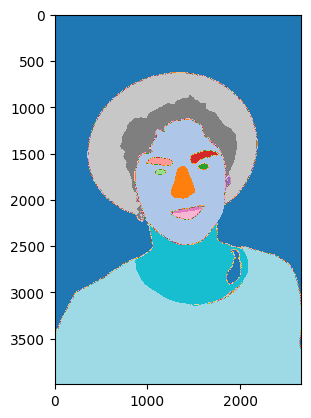

# Computer Vision With CNNs

This workshop teaches computer vision by starting with a single convolution and ending with a pretrained segmentation model. Students see how kernels respond to images, train a classifier, and then run semantic segmentation on a face image.

## Notebooks

| Notebook | Use |
| --- | --- |
| [CNNs.ipynb](CNNs.ipynb) | Student-facing workshop notebook. |
| [CNNs-Solved.ipynb](CNNs-Solved.ipynb) | Completed reference notebook. |

The [lecture slides](intro-to-cnns-lecture-slides.pdf) accompany these notebooks.

## What Students Build

- A visual convolution demo using hand-chosen kernels.
- A CNN classifier over image data.
- A comparison with transfer learning using pretrained Inception-v3 features.
- A model-evaluation section with confusion matrices and classification reports.
- A face-segmentation demo using a pretrained SegFormer model.

## Run It

This workshop was designed for Kaggle.

1. Import the notebook from GitHub.
2. Attach the UC Merced Land Use dataset when prompted.
3. Keep internet enabled for model downloads.
4. GPU is helpful but not required for the early convolution demos.

The classifier expects the image folders at `/kaggle/input/uc-merced-land-use-dataset/UCMerced_LandUse/Images`. Check this path against the attached UC Merced Land Use dataset; the dataset is not bundled here. The convolution and segmentation sections fetch example images and pretrained models over the internet.

For local use, change `data_dir` to the downloaded image folder and provide PyTorch, torchvision, Pillow, NumPy, Matplotlib, requests, scikit-learn, seaborn, tqdm and transformers. Run the student notebook's cells in order and complete its `TODO` prompts.

## Related Workshop

Continue with [CNN Class Visualisation](../cnn-class-visualisation/README.md) to explore what a pretrained network responds to by optimising its input pixels.

## Credits

This notebook was created by Edinburgh AI for use in its workshops. If you reuse it, please credit Edinburgh AI.
