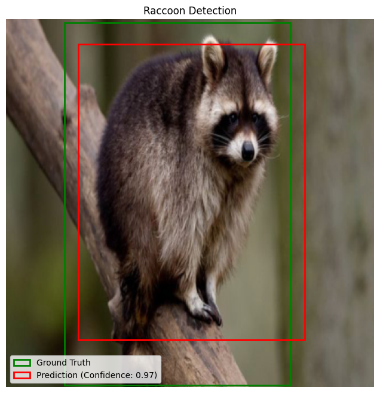

# Single-Object YOLO Detection

This workshop turns image classification into object detection. Students build the head of a single-object detector, define a bounding-box loss, train on an image dataset, and evaluate predictions using intersection over union.

## Notebooks And Support Files

| File | Use |
| --- | --- |
| [workshop-notebooks/unsolved-ediai-single-obj-detection.ipynb](workshop-notebooks/unsolved-ediai-single-obj-detection.ipynb) | Student-facing notebook. |
| [workshop-notebooks/solved-ediai-single-obj-detection-final.ipynb](workshop-notebooks/solved-ediai-single-obj-detection-final.ipynb) | Completed reference notebook. |
| [workshop-notebooks/ediai-single-obj-detection-solved-beta.ipynb](workshop-notebooks/ediai-single-obj-detection-solved-beta.ipynb) | Earlier solved beta notebook kept for reference. |
| [yolo-workshop-api](yolo-workshop-api) | Helper code and extra notes used by the notebooks. |
| [yolo-workshop-api/single-obj-yolo-presentation.pptx](yolo-workshop-api/single-obj-yolo-presentation.pptx) | Presentation deck for the session. |
| [single-obj-yolo-raccoon-lecture-slide.pdf](single-obj-yolo-raccoon-lecture-slide.pdf) | PDF lecture slides. |

The unsolved notebook and final solved notebook form the main workshop pair. The solved beta is an earlier reference kept in `workshop-notebooks/`; this topic has no `legacy/` directory. Its setup differs: the beta downloads helpers from a separate repository and expects a separately attached configuration file.

## What Students Build

- Data-wrangling code that normalizes bounding-box coordinates.
- A PyTorch model head on top of a provided convolutional backbone.
- A custom weighted loss over confidence and box coordinates.
- IoU-based evaluation and visual inspection of predicted boxes.

## Run It

This workshop was designed for Kaggle.

1. Import the unsolved notebook from GitHub.
2. Attach the Kaggle dataset [Raccoon Dataset](https://www.kaggle.com/datasets/debasisdotcom/racoon-detection).
3. Turn on internet access so the notebook can fetch the helper files from this repo.
4. Enable a GPU for the training section.
5. Run the notebook from top to bottom.

The main pair downloads [config.yaml](yolo-workshop-api/config.yaml) and the five helper modules into the notebook's working directory. A separate configuration dataset is not required for those notebooks. The CSV path is `/kaggle/input/racoon-detection/train_labels_.csv`; the dataset helper expects images under `/kaggle/input/racoon-detection/Racoon Images/images`.

For local use, provide pandas, PyTorch, torchvision, Pillow, scikit-learn, PyYAML and Matplotlib. Copy the helper modules and configuration into the working directory, and adapt the CSV, configuration and helper image paths to the downloaded dataset. The image root is hard-coded inside `RaccoonDataset`, so changing only the notebook CSV path is insufficient.

## Supporting Notes

Some explanatory links inside the notebooks still refer to the previous repository layout or an earlier helper repository. Use the current [helper README](yolo-workshop-api/README.md) for the dataset, model, loss, IoU and training notes, and the current [CNN reference notebook](../intro-to-convolutional-neural-networks/CNNs-Solved.ipynb) for the prerequisite refresher.

## Credits

Created for Edinburgh AI workshops. Please credit Edinburgh AI if you reuse or adapt the material.
